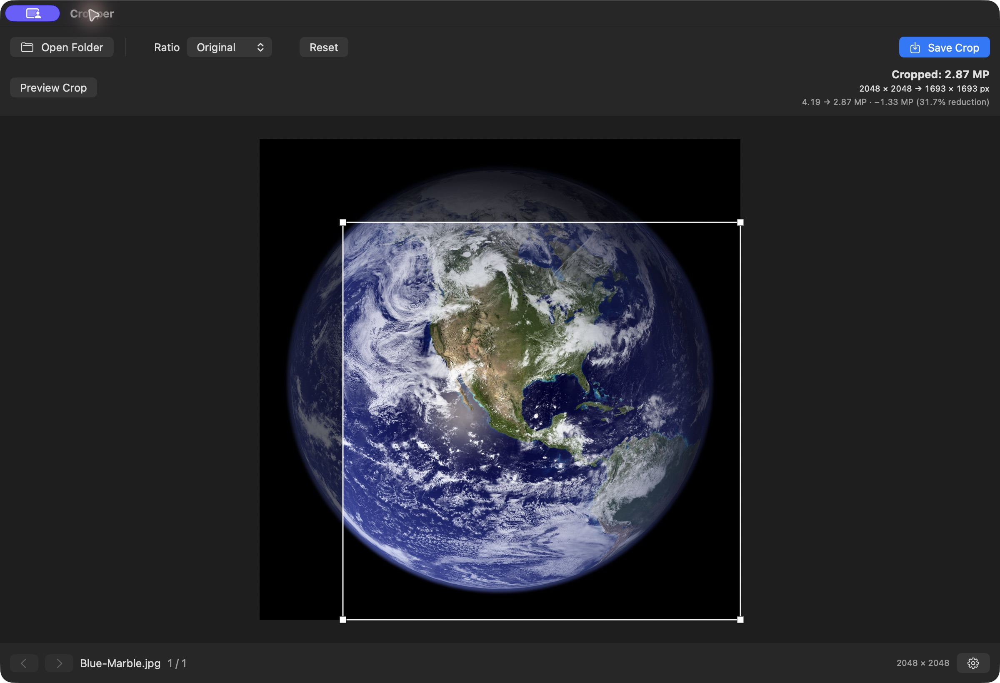
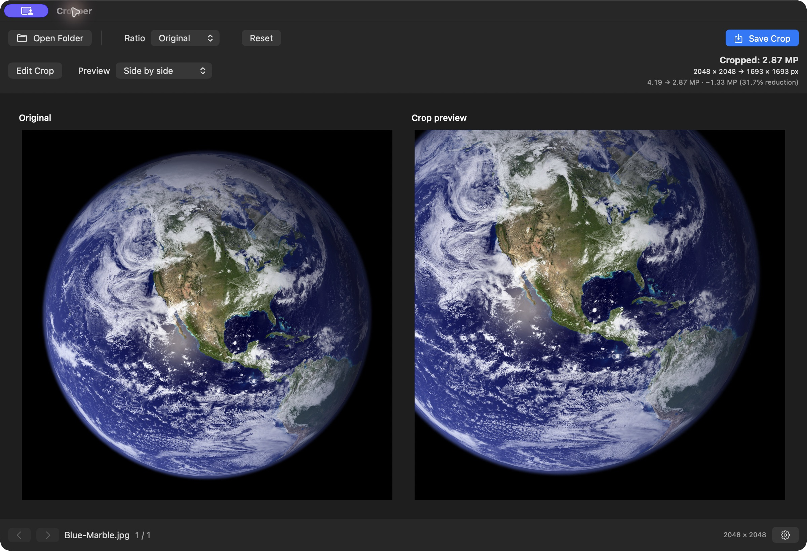

<p align="center"></p>

<p align="center">
  <a href="https://github.com/ThatXliner/Cropper/releases/latest"></a>
  <a href="https://github.com/ThatXliner/Cropper/actions/workflows/build.yml"></a>
  
  
</p>

A small, native macOS app for quickly cropping a folder of JPEGs. Open a folder, adjust the crop, press **Enter** or **⌘S**, and move to the next photo. Built with SwiftUI, AppKit, and ImageIO. Runs entirely offline with no third-party dependencies.

<p align="center"><strong><a href="https://github.com/ThatXliner/Cropper/releases/latest">Download Cropper for macOS →</a></strong></p>

## Screenshots

**Crop with live dimensions and megapixels**

<p align="center"></p>

**Compare the original and cropped result before saving**

<p align="center"></p>

Captured from Cropper 0.2.0 on macOS. Sample image: [Blue Marble](https://science.nasa.gov/resource/blue-marble-2002/), NASA's Earth Observatory.

## Install

1. Open the [latest release](https://github.com/ThatXliner/Cropper/releases/latest) and download `Cropper-<version>-universal.zip` under **Assets**. The source-code archives are for developers.
2. Unzip the download and drag **Cropper.app** into **Applications**.
3. Open Cropper. Requires **macOS 14 Sonoma or newer**, on Apple Silicon or Intel.

**First launch:** Releases are currently ad-hoc signed, not Developer ID signed or notarized. macOS may block an app downloaded from GitHub. After attempting to open it, go to **System Settings → Privacy & Security → Open Anyway**, then confirm the launch. Do this only if you trust this repository and the download. Managed Macs may require administrator approval. You can also build from source below.

To verify the downloaded ZIP, download `SHA256SUMS.txt` into the same folder and run:

```sh
shasum -a 256 -c SHA256SUMS.txt
```

## What it does

- **Fast folder browsing:** natural filename ordering, arrow-key navigation, and adjacent-image caching.
- **Interactive cropping:** drag anywhere on the image toward the center to resize, Shift-drag inside the crop to reposition, and see a dimmed area outside the crop.
- **Crop review:** cropped-only, side-by-side, and top-and-bottom previews. Switch with **⌘P** or the Preview Crop button; optionally preview automatically after dragging in Preferences. Previews show the selected area before saving.
- **Dimensions and megapixel reduction:** live original → cropped pixel dimensions, original and cropped megapixels, megapixels removed, and percentage reduction using the exact output dimensions.
- **Aspect ratios:** Original, Freeform, 1:1, 3:2, 4:3, 5:4, 16:9, and custom width:height.
- **Direct JPEG saving:** no export dialog, adjustable quality, and optional advance after saving.
- **Safe defaults:** preserves originals and saves uniquely named results into a `Cropped` subfolder. A separate output folder is available in Preferences. Overwriting originals requires explicitly enabling that preference.
- **Native appearance:** follows macOS light/dark mode, with a dark photo canvas.
- **Metadata and color:** carries standard EXIF/IPTC/GPS metadata and ICC color profiles through ImageIO, with correct visual orientation.
- **Optional lossless crops:** uses an existing jpegtran when the exact crop is eligible; otherwise uses normal JPEG encoding.

## Quick start

1. Press **⌘O** and choose a folder of JPEGs. Folder scanning is nonrecursive.
2. Pick an aspect ratio. For Custom, enter positive width and height values and press **Apply**.
3. Drag anywhere on the image toward the center to crop; the nearest corner follows your drag. Corner handles also work. Hold **Shift** and drag inside the crop to move it.
4. Use **Preview Crop** to review the result, then press **Enter** or **⌘S** to save. By default, the result is `Cropped/<name>-cropped.jpg`. Existing output files get a numbered suffix.
5. Press **→** for the next photo, or enable automatic advancement in Preferences (**⌘,**).

The + and − shortcuts preserve the crop center and aspect ratio and stop at the image boundaries or minimum crop size. The step is configurable from 1–25 percentage points in Preferences. For example, + changes 50% retained image area to 55% at the default step.

Navigation discards unsaved crop edits. Undo is available before saving; saved overwrites cannot be undone in Cropper.

### Keyboard shortcuts

| Shortcut | Action |
| --- | --- |
| **← / →** | Previous / next photo |
| **⌘O** | Open folder |
| **Enter / ⌘S** | Save crop (Enter confirms a focused text field while editing it) |
| **⌘P** | Toggle crop preview / editing |
| **Escape** | Return to editing when the canvas has focus |
| **+ / −** | Increase / decrease retained area by the configured percentage-point step (default 5) |
| **⌘Z** | Undo crop edit |
| **⌘R** | Reset to the largest rectangle for the selected ratio |
| **⌘1** | Original ratio |
| **⌘2** | Freeform |
| **⌘3** | 1:1 |
| **⌘4** | 3:2 |
| **⌘5** | 4:3 |
| **⌘6** | 5:4 |
| **⌘7** | 16:9 |
| **⌘8** | Custom ratio |
| **⌘,** | Preferences |

## Image quality and limitations

JPEG quality is configurable from 50–100%. Standard saving re-encodes the selected area at full resolution. EXIF pixel dimensions are updated. All eight EXIF orientations are handled: saved pixels retain the visual orientation, with the orientation tag normalized to 1.

Standard EXIF, TIFF, GPS, and IPTC properties are passed through ImageIO; the ICC color space is retained. Proprietary maker notes and embedded camera thumbnails are **not guaranteed to survive re-encoding**. Keep originals when those are essential.

Display previews are limited to 2400 pixels on their longest edge. A cache holds up to three previews with an 80 MB cost limit. The current image loads before neighboring images are prefetched on a background queue. Full-resolution decoding and encoding happen only while saving. An in-flight decode finishes before a newer request starts.

Tests include a synthetic **6960 × 4640 JPEG** (32.3 MP). Actual Canon EOS R7 files are not included; camera-specific metadata and performance need verification with real files. This MVP focuses on JPEG cropping, without RAW support or advanced editing tools.

### Optional lossless cropping

Enable **Try lossless JPEG cropping** in Preferences. Cropper looks for jpegtran at `/opt/homebrew/bin/jpegtran`, `/usr/local/bin/jpegtran`, or `/usr/bin/jpegtran`; installing it is optional.

Lossless saving is attempted only for orientation-1 images when the crop origin and dimensions are divisible by 16. This conservatively accommodates JPEG MCU sizes. It uses `-copy all -perfect`, verifies the output dimensions, and never expands the crop. Missing tools, ineligible crops, or tool failures fall back to normal JPEG encoding. The status bar shows which mode was used. In lossless mode, copied metadata remains verbatim, including original EXIF dimension fields.

## Build from source

Install Xcode or the Swift command-line tools, then:

```sh
git clone https://github.com/ThatXliner/Cropper.git
cd Cropper
./scripts/build-app.sh
open build/Cropper.app
```

The app bundle appears in `build/Cropper.app` and can be copied to Applications. The default build targets your Mac's architecture and is locally ad-hoc signed.

For development:

```sh
swift run Cropper
swift run Cropper /path/to/photos
swift test
```

Create the same universal ZIP used by GitHub Releases:

```sh
./scripts/package-release.sh
```

This builds both `arm64` and `x86_64`, combines them into one app, verifies its signature, and creates a ZIP and SHA-256 checksum in `build/release/`.

## Releases and contributions

GitHub Actions tests and packages the app on pushes to `main`, pull requests, and manual workflow runs. Those builds are available as the **Cropper-macOS** workflow artifact. Pushing a version tag publishes the ZIP and checksum to GitHub Releases after the build passes.

To release a new version, update `VERSION`, commit it, then push a matching tag:

```sh
git tag v0.1.1
git push origin main
git push origin v0.1.1
```

Tags must use `vMAJOR.MINOR.PATCH` and match `VERSION`. Release builds are currently unnotarized. Developer ID signing/notarization can be added when distribution credentials are available.

Bug reports and focused contributions are welcome. Please include your macOS version, Mac architecture, and a description of the steps to reproduce. Avoid posting private photos or metadata in public issues.
